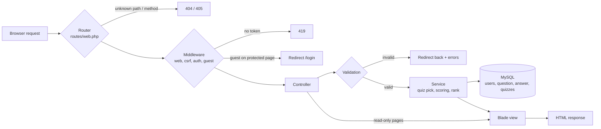

# Product Requirements Document (PRD) - mister-quiz

> **Version:** 1.0 (September 2026) · **Team:** hmim, ltzokas · **Source of truth:** [subject](mister-quiz.md) and [audit checklist](mister-quiz_audit.md). This PRD turns them into rules the team can build and test against.

## 1. Problem Statement

**Context:**  
We need to finish a **PHP web application** built on **Laravel 8.33.0**. 01-edu provides a starter with pages, models and migrations, but authentication, quiz flow, scoring, profile and leaderboard are missing or broken (bugs listed in Gitea issues #5–#14).

**Core Function:**  
The website lets a player register, log in, answer a quiz of questions from five categories, earn XP from right answers, see the results, follow their rank and statistics on a private profile, and compare with the top 10 players on a public leaderboard.

**Constraints:**
- Keep **Laravel 8.33.0** as locked in `composer.lock`. No framework upgrade, no `composer update`.
- **PHP 8.0.30** only, run through Docker (host wrappers `docker/bin/php`, `docker/bin/composer`).
- **MySQL 8.4.11** in Docker, database `mister_quiz`; phpMyAdmin 5.2.3 for inspection.
- The school audit PC (Linux + Docker) must start the project from a fresh clone with `docker compose up -d --build`.
- Categories are fixed: `Art`, `History`, `Geography`, `Science`, `Sports`.
- Category scores are stored in the format `x/y` (right / answered), as the subject and the starter schema require.
- Local development only; PHP 8.0 gets no security updates, so the app is never deployed publicly.

---

## 2. Target User & Use Case

- **Primary User:** quiz players using a desktop browser; the audit reviewer following the checklist.
- **Use Case:** *As a player, I register with a username, email and password, click **Start Quiz**, answer 20 questions from all five categories, and submit. I see how many I got right in total and per category. My XP and category scores grow, my profile shows my new rank, and if my XP is high enough I appear on the leaderboard.*

---

## 3. System Contract

*How the outside world interacts with the program.*

### 3.1 CLI Contract (environment)
- **Command** `docker compose up -d --build`
- **Input:**
  - **`.env`:** Optional. Created from `.env.example` on first start. `APP_PORT` (default `8000`) and `PHPMYADMIN_PORT` (default `8080`) may change; `DB_*` values must not.
  - **Question data:** Required once. `questions_and_answers.sql` from 01-edu (or the seeder from issue #4).
- **Output:** services `app` (Laravel dev server on `:8000`), `db` (MySQL, not published), `phpmyadmin` (`:8080`). The `app` entrypoint runs `composer install`, creates `.env` and `APP_KEY` when missing, and runs `php artisan migrate --force`.
- **Developer commands:** `php artisan …` and `composer install` through the wrappers (see [Installation guide](Installation-guide.md)).

### 3.2 Web / HTTP Contract

> Planned contract. Final paths and route names are fixed in issues #20 and #25; update this table then.

| Method | Endpoint | Route name | Access | Payload | Response |
|---|---|---|---|---|---|
| GET | `/` | `home` | everyone | — | `200 OK`, homepage with 3 (guest) or 4 (logged-in) buttons |
| GET | `/register` | `register` | guests | — | `200 OK`, register form |
| POST | `/register` | — | guests | `username`, `email`, `password`, `password_confirmation`, `_token` | `302` → `/` and signed in · `302` → `/register` with errors |
| GET | `/login` | `login` | guests | — | `200 OK`, login form |
| POST | `/login` | — | guests | `email`, `password`, `_token` | `302` → `/` and signed in · `302` → `/login` with error |
| POST | `/logout` | `logout` | logged in | `_token` | `302` → `/`, session ended |
| GET | `/quiz` | `quiz` | logged in | — | `200 OK`, the open quiz (created if none) · guests `302` → `/login` |
| POST | `/quiz/{quiz}` | `quiz.submit` | owner of the quiz | `answers[<question_id>] = <answer_id>`, `_token` | `302` → `/quiz/{quiz}/results` (also for a quiz that was submitted before) · `302` → `/quiz` with error |
| GET | `/quiz/{quiz}/results` | `quiz.results` | owner of the quiz | — | `200 OK`, results page · quiz not submitted `302` → `/quiz` with error · another user `403` · guests `302` → `/login` |
| GET | `/profile` | `profile` | logged in | — | `200 OK`, own profile · guests `302` → `/login` |
| GET | `/leaderboard` | `leaderboard` | everyone | — | `200 OK`, top 10 table |

**Data contract (database):**

| Table | Key columns | Notes |
|---|---|---|
| `users` | `id`, `username`, `email` (unique), `password`, `xp` (int, default 0), `art`, `history`, `geography`, `science`, `sports` (string `x/y`, default `0/0`) | Total right answers: stored or derived, decided in issue #3 |
| `question` | `id`, `question`, `xp`, `category` | 60 rows from 01-edu (12 per category) |
| `answer` | `id`, `answer`, `correct`, `question_id` | 4 answers per question, exactly 1 correct |
| `quizzes` | `id`, `user_id`, `completed` | At most one open quiz (`completed = 0`) per user |
| quiz ↔ question pivot | `quiz_id`, `question_id`, order | Missing in the starter; added in issue #10 |

---

### 3.3 Error Handling Expectations

- **Missing Input:** form fields are validated on the server; the user returns to the form with a message per field and keeps the typed values (except passwords).
- **Invalid Input:** wrong login → `These credentials do not match our records.`; duplicate email → `The email has already been taken.`; incomplete quiz → error and nothing scored.
- **Wrong Address or Method:** an address that no route defines (`/profile/2`) → `404`. An address that exists, but not for this method (`GET /quiz/c`, because `/quiz/{quiz}` is `POST` only) → `405` with an `Allow` header. Both show the same style of error page. Details: [error-cases.md](error-cases.md) E18–E22 and the README, section Error Handling.
- **Edge Cases:** `0/0` shows `0%`; rank ranges are half-open; a second submit of the same quiz changes nothing; a leaderboard with fewer than 10 players shows only real rows. Details: [edge-cases.md](edge-cases.md).

---

## 4. Functional Requirements (Rules)

*The source of truth for how the core logic works.*

### 4.1 Data & Resource Management
- **R1 – Schema:** migrations in `database/migrations/` define every table in [3.2](#32-web--http-contract). The schema is reviewed by both members before feature work (issue #3) and changes only through a PR approved by both.
- **R2 – Question data:** 60 questions and 240 answers from the 01-edu SQL file, or a seeder that can run twice without duplicating rows (issue #4).
- **R3 – Views:** Blade templates in `resources/views/`; the question component shows every answer (issue #11). User data is always printed with `{{ }}`.
- **R4 – Messages:** validation and auth texts come from `resources/lang/en/`.
- **R5 – Tests:** PHPUnit uses a separate database (SQLite in memory, issue #14) and never the `mister_quiz` data.

### 4.2 Core Logic & Processing

**Authentication**
- **R6 – Register:** `username` required, max 255; `email` required, valid, max 255, unique in `users`; `password` required and confirmed. On success: hash the password, create the user (`xp = 0`, all categories `0/0`), sign in, redirect to `/`.
- **R7 – Login:** `email` and `password` required. `Auth::attempt()` with both. Success → regenerate the session, redirect to `/`. Failure → back to `/login` with the `auth.failed` message.
- **R8 – Logout:** `POST` only; log out, invalidate the session, regenerate the CSRF token, redirect to `/`.
- **R9 – Navigation:** Login links to Register and Register links to Login. Logged-in users who open either page go to `/`.

**Homepage**
- **R10 – Buttons:** guests see `Login`, `Leaderboard`, `Start Quiz`. Logged-in players see `Profile`, `Leaderboard`, `Start Quiz`, `Logout`. Every button points to a defined route (issue #5).

**Quiz**
- **R11 – Guard:** `Start Quiz` for a guest redirects to `/login` without creating a quiz.
- **R12 – Selection:** a new quiz takes up to 4 random questions per category (20 with the 01-edu data), at least 1 per category, no duplicates, then shuffles them once. If any category has no questions, no quiz is created and a message is shown.
- **R13 – Persistence:** the quiz, its questions and their order are saved in the database. While the quiz is open, every `GET /quiz` (refresh, return from the homepage, new login) shows the same questions in the same order. A new quiz is created only when the user has no open quiz.
- **R14 – Display:** every question shows its text, its category and its answers as one-choice inputs marked `required`; one Submit button at the bottom.
- **R15 – Submit validation:** the quiz belongs to the user (`403` otherwise) and is still open. The submitted answers cover every question of the quiz, and each answer id belongs to its question. Otherwise → back to `/quiz` with an error; nothing is scored.

**Scoring and results**
- **R16 – Correctness:** an answer is right when the chosen answer row has `correct = 1`. Compare ids, not texts.
- **R17 – XP:** `user.xp += sum(question.xp)` over the right answers, added once.
- **R18 – Category scores:** for each category, `x += right answers in this quiz`, `y += questions of that category in this quiz`, stored again as `"x/y"`.
- **R19 – Atomic submit:** marking the quiz `completed = 1` and updating the user happen in one transaction; only an open quiz can be scored, so a repeated submit changes nothing.
- **R20 – Results page:** shows `right / total` for the whole quiz and right answers per category (with the number of questions of that category).

**Profile**
- **R21 – Access:** `auth` middleware; the page shows only the logged-in user; no profile-by-id route.
- **R22 – Content:** username, email, XP, rank, and for each category: right (`x`), answered (`y`) and percentage `round(x / y × 100)`, with `0%` when `y = 0`.
- **R23 – Rank:** `xp < 1500` → Quiz Aprentice; `1500 ≤ xp < 5000` → Average Quizer; `5000 ≤ xp < 10000` → Epic Quizer; `xp ≥ 10000` → Quiz Master (proposed half-open ranges, issue #32). One method computes it.

**Leaderboard**
- **R24 – Query:** users ordered by `xp` descending, then `username` ascending (proposed, issue #35), limit 10.
- **R25 – Rows:** username, XP, total right answers (sum of the five `x` values, or the stored total from issue #3). No email.
- **R26 – Access:** public. With fewer than 10 users it shows only real rows; with none, an empty-state text.

### 4.3 Error Handling Philosophy
The program follows a **validate-first, fail-safe** strategy.
- **Invalid Input:** Laravel validation before any write; `302` back to the form with field messages (`422` for JSON). Duplicate or tampered data never reaches the database as an exception.
- **Access:** `auth` / `guest` middleware and ownership checks; `403` for another user's quiz, `404` for unknown resources and paths, `405` for wrong methods, `419` for missing CSRF tokens.
- **Server/Internal Errors:** Laravel's `500` page; with `APP_DEBUG=false` no stack trace, SQL or path reaches the browser; details go to `storage/logs/laravel.log`.

---

## 5. Non-Goals (Out of Scope)

*What the program will NOT do.*

- No upgrade of Laravel or PHP; no new Composer packages without an approved issue.
- No public deployment or production hosting.
- No password reset, email verification, social login or "remember me" requirement.
- No admin panel for adding or editing questions; questions come from the SQL file or the seeder.
- No timer, lives, jokers or "Who Wants to Be a Millionaire" money ladder.
- No viewing of other players' profiles.
- No REST/JSON API and no single-page frontend framework; server-rendered Blade only.
- No multi-language interface; English only.

---

## 6. Acceptance Criteria

*To satisfy the Definition of Done (DoD), the project must pass the test documents in `_docs/`: [audit-cases.md](audit-cases.md), [error-cases.md](error-cases.md) and [edge-cases.md](edge-cases.md). All 14 audit cases must pass; the lists below are the most important cases.*

### 6.1 Core Functionality & Audit Cases
- [ ] **Audit Case C01**: ***Fresh clone starts with one command*** | **Input Argument**: `docker compose up -d --build` | **Expected Behavior/Output**: `app`, `db` (healthy), `phpmyadmin` up; all migrations ran
- [ ] **Audit Case W01 + W02**: ***Register and log in*** | **Input Argument**: `POST /register` (4 fields), `POST /login` (email, password) | **Expected Behavior/Output**: `302` → `/`, user signed in
- [ ] **Audit Case W04 + W05**: ***Homepage buttons*** | **Input Argument**: `GET /` as guest / as player | **Expected Behavior/Output**: 3 buttons (Login, Leaderboard, Start Quiz) / 4 buttons (Profile, Leaderboard, Start Quiz, Logout)
- [ ] **Audit Case W10**: ***Results after a complete submit*** | **Input Argument**: `POST /quiz/{quiz}` with every answer | **Expected Behavior/Output**: right/total and right per category; XP and `x/y` updated once
- [ ] **Audit Case W11**: ***Profile content*** | **Input Argument**: `GET /profile` | **Expected Behavior/Output**: username, email, XP, correct rank, per-category right / answered / %
- [ ] **Audit Case W12 + W13**: ***Leaderboard*** | **Input Argument**: `GET /leaderboard` | **Expected Behavior/Output**: top 10 by XP; username, XP, total right answers

### 6.2 Error & Validation Cases
- [ ] **Error Case E06**: ***Wrong login details*** | **Input Argument**: `POST /login` with a wrong password | **Expected Behavior/Output**: `302` → `/login` + `These credentials do not match our records.`
- [ ] **Error Case E09**: ***Email already registered*** | **Input Argument**: `POST /register` with an existing email | **Expected Behavior/Output**: `302` → `/register` + `The email has already been taken.` (no `500`)
- [ ] **Error Case E11**: ***Quiz submitted with a missing answer*** | **Input Argument**: `POST /quiz/{quiz}` without one answer | **Expected Behavior/Output**: `302` → `/quiz` + error; nothing scored
- [ ] **Error Case E12**: ***Guest opens a protected page*** | **Input Argument**: `GET /quiz`, `GET /profile` | **Expected Behavior/Output**: `302` → `/login`
- [ ] **Error Case E13**: ***Tampered quiz submit*** | **Input Argument**: another user's quiz / unknown quiz / foreign answer id | **Expected Behavior/Output**: `403` / `404` / `302` + error; nothing scored
- [ ] **Error Case E18**: ***Wrong method on the quiz submit address*** | **Input Argument**: `GET /quiz/c`, `GET /quiz/1` | **Expected Behavior/Output**: `405` + `Allow: POST` (the address exists for `POST` only), the `405` page looks like the `404` page
- [ ] **Error Case E19**: ***Unknown quiz id on the submit address*** | **Input Argument**: `POST /quiz/c`, `/quiz/0`, `/quiz/-1`, `/quiz/1.5`, `/quiz/1abc`, `/quiz/999999` (logged in) | **Expected Behavior/Output**: `404`; nothing scored
- [ ] **Error Case E20**: ***Method that the submit address never accepts*** | **Input Argument**: `PUT /quiz/1`, `DELETE /quiz/1` | **Expected Behavior/Output**: `405` + `Allow: POST`
- [ ] **Error Case E21**: ***Write method on a page that only reads*** | **Input Argument**: `POST /`, `/quiz`, `/profile`, `/leaderboard` | **Expected Behavior/Output**: `405` + `Allow: GET, HEAD`
- [ ] **Error Case E22**: ***Address with an extra part or other letter case*** | **Input Argument**: `GET /profile/2`, `/leaderboard/1`, `/quiz/1/answers`, `/Quiz` | **Expected Behavior/Output**: `404`

### 6.3 Edge & Boundary Cases
- [ ] **Edge Case EC01**: ***Rank boundaries*** | **Input Argument**: XP 1499, 1500, 4999, 5000, 9999, 10000 | **Expected Behavior/Output**: Aprentice, Average, Average, Epic, Epic, Master
- [ ] **Edge Case EC02**: ***New player profile*** | **Input Argument**: `GET /profile` with all `0/0` | **Expected Behavior/Output**: `0 / 0`, `0%`, Quiz Aprentice, no crash
- [ ] **Edge Case EC05**: ***Open quiz survives logout*** | **Input Argument**: Start Quiz → logout → login → Start Quiz | **Expected Behavior/Output**: same questions, same order
- [ ] **Edge Case EC06**: ***Quiz submitted twice*** | **Input Argument**: two submits of the same quiz | **Expected Behavior/Output**: scored once; second submit changes nothing
- [ ] **Edge Case EC09**: ***Equal XP on the leaderboard*** | **Input Argument**: several users with the same XP | **Expected Behavior/Output**: stable order, XP ↓ then username ↑, 10 rows

---

## 7. Implementation Approach (Architecture)

### 7.1 Architectural Overview
The project follows Laravel's **MVC** architecture with a thin **service layer** for the game rules.
- **Pattern:** MVC (routes → middleware → controllers → models/services → Blade views) plus a `QuizScoringService`-style class for quiz picking, scoring and ranks.
- **Reasoning:** MVC is what the starter and the subject use, so both members work in familiar places (`app/Http/Controllers`, `app/Models`, `resources/views`). Keeping XP, `x/y` and rank rules in one service makes them unit-testable without views and avoids copying the same logic into the results, profile and leaderboard controllers.
- **Tradeoffs we accept:** category scores stay as `x/y` strings (subject requirement) instead of numeric columns, so every update parses and rebuilds text and the leaderboard total needs either a sum in PHP/SQL or an extra stored column (issue #3). No repository or DTO layers: less abstraction, faster delivery for a 2-person project.

---

### 7.2 System Flowchart

### 7.3 Module Responsibilities
- **Input Layer:** `routes/web.php` (paths, names, methods, middleware); `Auth/*Controller` and `Questions/QuestionController` validation; CSRF via the `web` middleware group.
- **Domain Model:** Eloquent models `User`, `Question`, `Answer`, `Quiz` and the quiz ↔ question relation; the scoring service (question selection, correctness, XP, `x/y` update, rank, percentage); database transactions for submits.
- **Output Layer:** Blade views `home`, `auth/login`, `auth/register`, `questions/list`, `questions/results`, `profile`, `leaderboard` and the `components/question` component; error pages from Laravel.

---

## 8. Milestones & Roadmap

Each milestone is a Gitea milestone. Work happens on `dev` through feature branches; `main` receives a reviewed PR at the end of each milestone.

- **M0: Environment & shared schema** – Docker environment (done, #1), both PCs verified (#2), schema review (#3), question seeder (#4). *Done when:* C01, C02 pass on both PCs.
- **M1: Auth** – register, login with error, POST logout, forms with links (#15–#19; bugs #6, #7, #8). *Done when:* W01–W03, E06–E10 pass.
- **M2: Homepage buttons** – routes for Profile, Leaderboard, Start Quiz; 3/4 buttons (#20–#22; bug #5). *Done when:* W04, W05 pass and the starter test for `/` is green.
- **M3: Start quiz & persistence** – guest redirect, selection with every category, saved quiz and pivot (#23–#25; bugs #9, #10). *Done when:* W06, W09, W14, EC04, EC05, E05 pass.
- **M4: Question screen & submit rules** – answers shown, server-side completeness check, error message (#26–#28; bug #11). *Done when:* W07, W08, E11, E13 pass.
- **M5: Results page** – totals per quiz and per category, XP and `x/y` updates, layout (#29–#31; bug #12). *Done when:* W10, EC03, EC06 pass.
- **M6: Profile page** – rank, per-category numbers and percentages, access (#32–#34). *Done when:* W11, EC01, EC02, E12 pass.
- **M7: Leaderboard** – top 10 query and table (#35, #36). *Done when:* W12, W13, EC08, EC09 pass.
- **M8: Testing & polish** – feature and unit tests, test database, factory fix, visual check, final review (#37–#39; bugs #13, #14). *Done when:* C03 passes and every case in the three test documents is checked.

---

## 9. Risks & Open Questions

### 9.1 Risk Assessment

| Risk | Impact | Mitigation Strategy |
|---|---|---|
| Different PHP / tool versions between the two PCs or the audit PC | High | PHP, Composer and MySQL run only in Docker with pinned tags; strict [Installation guide](Installation-guide.md); checklist posted in issue #2; fresh-clone test before each `main` merge. |
| PHP 8.0 and Laravel 8.33 are end-of-life (no security fixes) | Medium | Local use only; no public deployment; no new dependencies. |
| Both members change the schema at the same time | High | Schema agreed in issue #3; migrations only through reviewed PRs; one migration per PR. |
| XP or category scores counted twice (double submit, starter bug) | High | Transaction + "only open quizzes can be scored" (R19); feature test for EC06. |
| Quiz changes on refresh because it lives only in the session | High | Store quiz, questions and order in the database (R13); test EC05. |
| Tests wipe the development database | Medium | SQLite in memory for PHPUnit (issue #14); `RefreshDatabase` only there. |
| Ambiguous rank limits lead to a wrong rank in the audit | Medium | Half-open ranges agreed in #32 and covered by a unit test (EC01); README states the limits. |
| Question data imported twice | Low | Idempotent seeder (#4); count check in C02 / E04. |
| Merge conflicts in shared views (`home`, `app` layout) | Medium | One peer per module (see [MILESTONES.md](MILESTONES.md#3-split-by-module-not-by-issue)); small PRs; pull `dev` before starting. |

### 9.2 Open Questions

- **Question:** Which rank applies at exactly 5000 and 10000 XP, and do we keep the subject's spelling "Quiz Aprentice"? (issue #32)
  - *Decision:* Proposed half-open ranges (5000 → Epic Quizer, 10000 → Quiz Master) and the subject's spelling. To be confirmed by both members.
- **Question:** Is "total correct answers" stored in its own column or computed from the five `x/y` columns? (issue #3)
  - *Decision:* To be decided in the schema review before M1.
- **Question:** Does the homepage Profile button show the word "Profile" or the username? (issue #22)
  - *Decision:* To be decided in M2; the audit asks for a "Profile button".
- **Question:** Should usernames be unique? The subject does not require it, but duplicates look confusing on the leaderboard.
  - *Decision:* To be decided in the schema review (issue #3).
- **Question:** How are percentages rounded, and how is `0/0` shown? (issue #33)
  - *Decision:* Proposed `round()` to a whole number and `0%` for `0/0`.
- **Question:** How are equal XP values ordered on the leaderboard? (issue #35)
  - *Decision:* Proposed XP descending, then username ascending.
- **Question:** Is the quiz always 20 questions (4 per category)?
  - *Decision:* Keep the starter's 4 per category; totals are computed from the actual quiz, so smaller pools still work (EC04).
